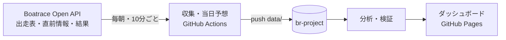

# br-project

競艇（ボートレース）の出走表・直前情報・結果・払戻を自動で集め、
「期待値派」（モデルの確率と想定オッズから期待値を出し、割安なときだけ買う）で
予想・検証するシステム。競馬版 kb-project と同じ仕組み。

* ダッシュボード：https://momokuomomo-crypto.github.io/br-project/
* 対象：全24場・全グレード、過去5年分

## 仕組み

公式サイトはプログラムからの取得を拒否するため、自動取得を前提に公開されている
非公式の Boatrace Open API を使う。オッズは手に入らないため、過去の払戻実績から
推定した「想定オッズ」で期待値を計算する（詳細は仕様書）。

## 仕様書

| 設計書 | 内容 |
|---|---|
| [00_要件定義](docs/00_要件定義.md) | 目的・決定事項・構成 |
| [01_01_データ仕様](docs/01_foundation/01_01_データ仕様.md) | CSVの列・フォルダ構成 |
| [02_01_データ取得設計](docs/02_collect/02_01_データ取得設計.md) | データ元からの取得・変換 |
| [04_01_期待値派モデル設計](docs/04_analysis/04_01_期待値派モデル設計.md) | 確率モデル・想定オッズ・購入ルール・当日予想 |
| [04_02_検証設計](docs/04_analysis/04_02_検証設計.md) | 学習・選定・確認の3期間での検証 |
| [06_01_自動実行設計](docs/06_pipeline/06_01_自動実行設計.md) | GitHub Actions |
| [06_02_ダッシュボード設計](docs/06_pipeline/06_02_ダッシュボード設計.md) | 表示内容 |

実装ルールは [IMPLEMENTATION_GUIDE.md](IMPLEMENTATION_GUIDE.md)（競馬版と同じ）。
